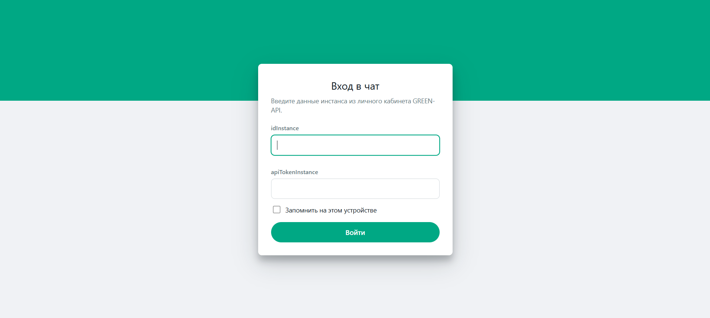
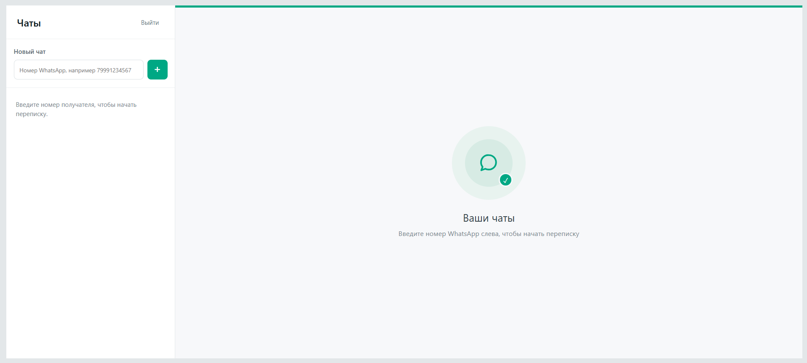
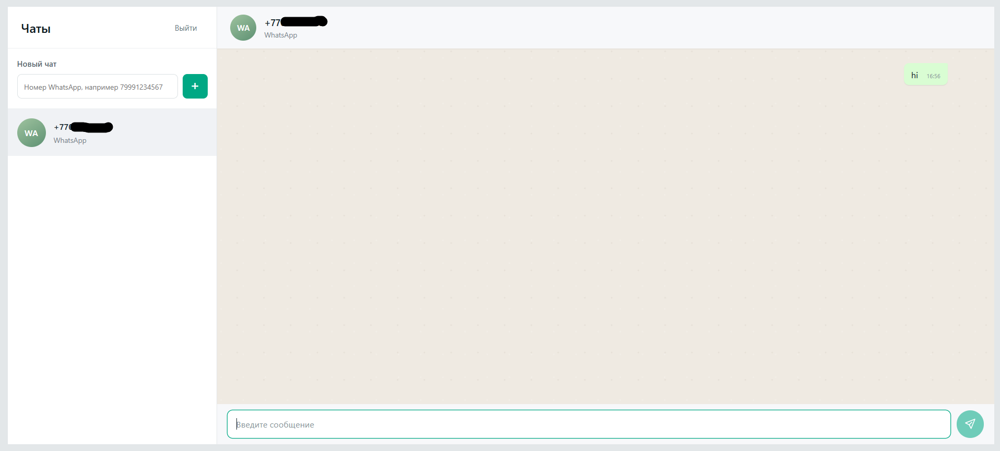

# WhatsApp чат на GREEN-API

Тестовое задание выполнено для WhatsApp с использованием React и сервиса GREEN-API.

Приложение позволяет войти с учетными данными GREEN-API, создать чат по номеру телефона, отправлять текстовые сообщения и получать сообщения из WhatsApp.

## Технологии

- React
- TypeScript
- Vite
- GREEN-API для WhatsApp

## Запуск приложения

1. Установите Node.js и зависимости проекта:

   ```bash
   npm install
   ```

2. Создайте файл `.env` на основе `.env.example`:

3. В `.env` укажите адрес API для своего инстанса GREEN-API в переменной `VITE_GREEN_API_URL`. Адрес можно посмотреть в настройках инстанса в личном кабинете GREEN-API. Например:

   ```env
   VITE_GREEN_API_URL=https://your-instance.api.green-api.com
   ```

4. Запустите приложение:

   ```bash
   npm run dev
   ```

## Сборка

```bash
npm run build
```

## Скриншоты

### Вход



### Список чатов



### Переписка


